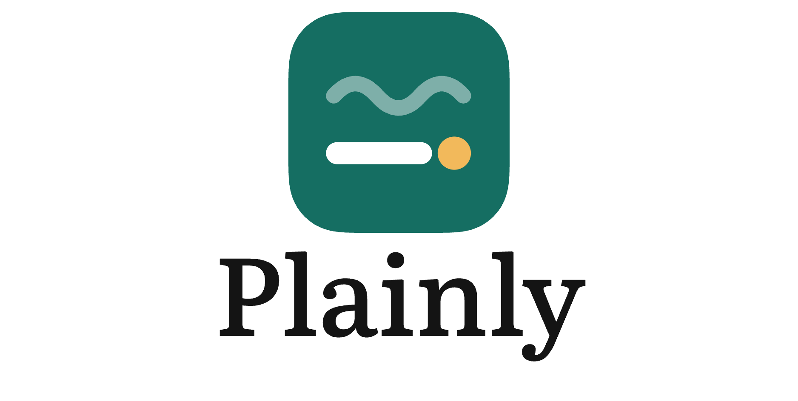
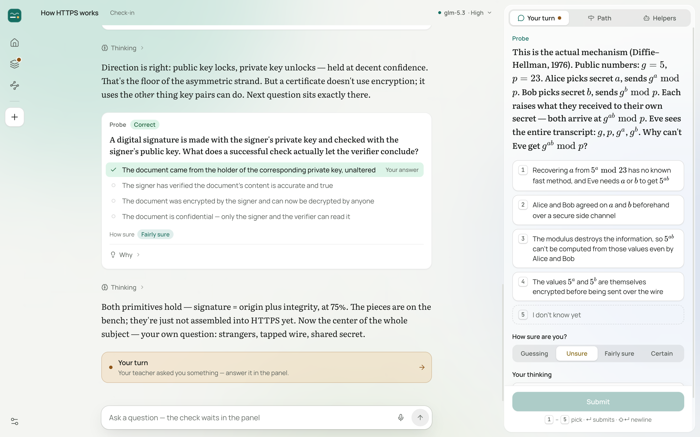
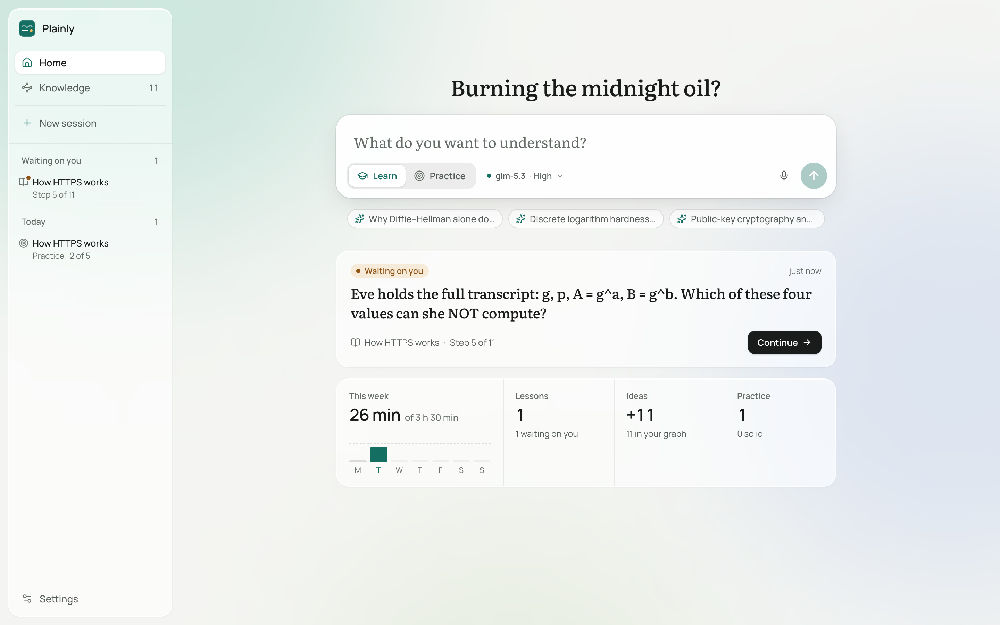
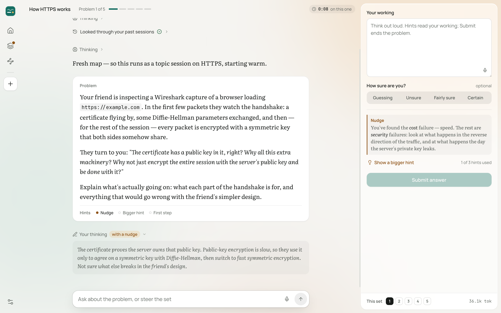
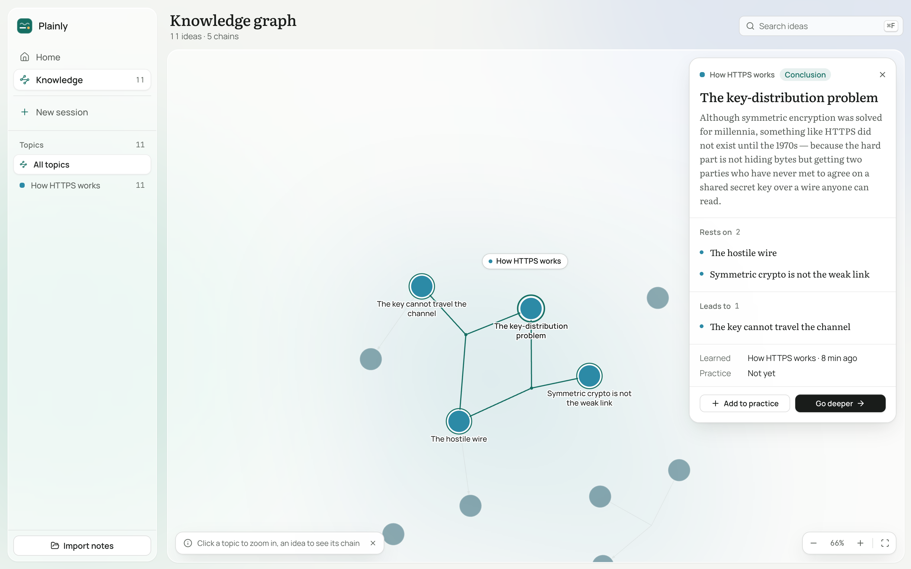

<p align="center">
  <picture>
    <source media="(prefers-color-scheme: dark)" srcset="docs/assets/plainly_banner_dark.png">
    <source media="(prefers-color-scheme: light)" srcset="docs/assets/plainly_banner_light.png">
    
  </picture>
</p>

<p align="center"><strong>An agent harness for learning.</strong></p>

<p align="center">
  <a href="https://github.com/dataguyofprocol/plainly/releases">Download</a> ·
  <a href="#how-it-works">How it works</a> ·
  <a href="#whats-new-in-010">What's new</a> ·
  <a href="docs/development.md">Documentation</a> ·
  <a href="https://github.com/dataguyofprocol/plainly/issues">Issues</a>
</p>

Plainly uses AI agents to plan and teach lessons from your current understanding to your goal. It builds a detailed picture of what you understand and how you reason. That picture is updated as you learn.

Instead of just giving you an explanation, it uses your answers and thinking to decide what you need next. Teaching builds understanding one reasoning step at a time. Practice makes it usable. A persistent knowledge graph carries it across sessions.



## How it works

1. **Measure.** Before teaching, the agent finds where your understanding ends on each part the lesson depends on. Your answers, how sure you are, and your thinking show it where to start.
2. **Plan.** It works out a dependency map from that starting point to your goal. The Path tab shows the plan and where you are in it, and the lesson adapts when your understanding turns out different.
3. **Teach.** Each step builds on something you already understand. You predict, read the explanation, and check your understanding. The question sits in a panel beside the text, so you can read and answer side by side. Confusions are repaired before anything is built on them. The aim is for the goal to feel obviously true, not merely familiar.
4. **Practice.** Separate sessions pose sets of five problems that need the right knowledge to come to mind without being named first. You work in the panel and ask for help one step at a time: a nudge, a bigger hint, then the first step.

**Think out loud.** Every question has a thinking field for your reasoning, uncertainties, and reactions in your own words, and a four-level "How sure?" switch: guessing, unsure, fairly sure, certain. This is how the agent gets a detailed picture rather than just a record of right and wrong answers. You can type or use dictation.

The agent can also research questions in the background, create visual explanations, and build interactive demonstrations.

## Pick up where you left off



Home has one field. Type what you want to understand and choose **Learn** or **Practice**, or pick one of the suggestions drawn from your graph. Below it, **Continue** shows the question that is waiting on you, and **This week** shows your minutes against a weekly goal, with lessons, new ideas, and practice alongside.

Press ⌘K anywhere to start a session or find a past session or idea. Lessons and practice sets waiting on you stay listed in the sidebar.

## Practice



Your working goes in the panel. Hints read what you have written so far and answer only the next thing you are stuck on, so a nudge is a sentence or two, not a solution. The problem card records which hints you used, and **This set** tracks each of the five problems: solved, solved with hints, or skipped.

## Knowledge that carries forward

What you are taught accumulates as propositions and reasoning chains: individual claims and the premises that lead to them. The Knowledge page shows this structure by topic, with links back to the sessions it came from. You can also import notes.



Select an idea to light its chain and see what it rests on and what it leads to. **Add to practice** queues it for a practice set; **Go deeper** opens a new session on it. Future teaching sessions read the graph instead of starting from scratch. It stores the ideas and their connections, not ratings of your ability.

## Download and get started

**[Download from GitHub Releases](https://github.com/dataguyofprocol/plainly/releases)**

- **macOS (Apple Silicon):** DMG. Drag the app to Applications. The app is not yet signed with an Apple Developer ID, so the first time, right-click it and choose **Open**.
- **Windows (x64):** run the installer. It is currently unsigned; Windows may show an “unknown publisher” or SmartScreen warning.
- **Linux (x64):** make the AppImage executable and open it, or install the Debian/Ubuntu `.deb`.

On first launch, connect a provider: OpenAI, OpenRouter, Anthropic, DeepSeek, Z.AI, or any OpenAI-compatible endpoint (Ollama, vLLM, and similar), with 30+ options in all. Then choose your models and start a session with what you want to understand. Optional dictation and web search use separate service keys.

Windows and Linux update in-app. On macOS, in-app updates need a Developer ID signature, so for now download new versions from Releases.

## What's new in 0.1.0

Plainly 0.1.0 is the first release under the new name. Compared with LearnHarness 0.3.7, it adds:

- **A new interface.** A calmer, redesigned look throughout, with a grouped sidebar that folds to a rail, and ⌘K to start or find anything.
- **Home.** One composer for Learn and Practice, what is waiting on you, and a weekly progress strip with a goal.
- **Lessons with a side panel.** The open question, the plan (Path), and background helpers sit beside the text instead of under it.
- **Four-level confidence.** "How sure?" is guessing, unsure, fairly sure, or certain.
- **Practice rebuilt.** A working panel, sets of five, and short hints in three steps: nudge, bigger hint, first step.
- **Knowledge page.** Topics, an idea card with what each idea rests on and leads to, and Add to practice / Go deeper.
- **Custom providers.** Connect any OpenAI-compatible endpoint, with its models listed alongside the built-in ones.
- **Moving from LearnHarness.** On first launch, Plainly copies your LearnHarness data into its own folder. The original folder is left untouched.

## Your keys, your data

- **Your keys and models.** No Plainly subscription or markup. You pay your providers for usage; a live cost meter shows model costs.
- **Local storage.** Your chats, graph, settings, and API keys live on your machine. Learning records are plain files you can inspect.
- **External services.** Models run through your configured providers. Model requests send the context needed for the task; web research and dictation also contact external services. Local storage does not mean offline processing.
- **Inspectable behavior.** System prompts are visible and editable. The app is open source under the AGPL-3.0 license.

## Development and support

```bash
npm install
npm run dev        # http://localhost:3000
npm test           # deterministic, no LLM, no network
```

See the [development guide](docs/development.md), [architecture](docs/architecture.md), and [desktop release guide](docs/desktop-release.md).

Questions, bug reports, and feature requests: [GitHub Issues](https://github.com/dataguyofprocol/plainly/issues).

## License

[AGPL-3.0](LICENSE). Based on [LearnHarness](https://github.com/amosblomqvist/learnharness) by Amos Blomqvist; see [NOTICE](NOTICE).
